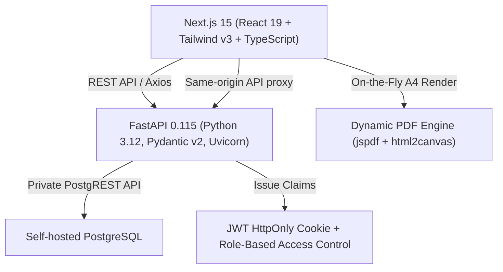
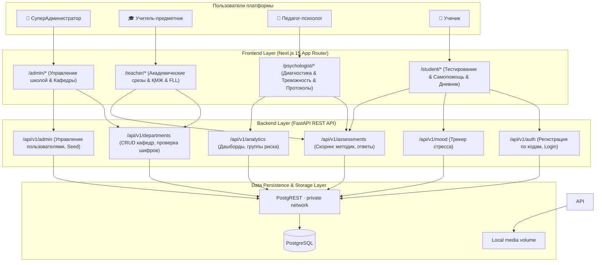

# 🌟 AISezim Platform — Comprehensive Educational & Psychological School Management Ecosystem

## Запуск в один клик (Windows)

1. Установите Docker Desktop и дождитесь, пока он запустится.
2. Дважды щёлкните `Start-AISezim.cmd` в корне проекта.
3. Откройте `http://localhost:3000` после сообщения о запуске.

При первом запуске рядом с проектом автоматически создаётся закрытый Git-ом `.env` со случайными секретами. Первый запуск скачает и соберёт Docker-образы и займёт несколько минут. Для повторного запуска достаточно снова открыть `Start-AISezim.cmd`; данные базы и аудио сохраняются в Docker volumes.

Чтобы остановить сервисы без удаления данных, выполните `docker compose -f docker-compose.yml -f docker-compose.desktop.yml down` в папке проекта. Не добавляйте `-v`, если нужно сохранить данные.

Для VPS после настройки публичного `DOMAIN`, DNS и `.env` используйте `bash ops/start-vps.sh`; подробности описаны в `docs/VPS_DEPLOYMENT.md`.

<div align="center">


[](https://nextjs.org/)
[](https://fastapi.tiangolo.com/)
[](https://www.postgresql.org/)
[](https://www.typescriptlang.org/)
[](https://tailwindcss.com/)

**AISezim** — это единая цифровая экосистема для современной школы, объединяющая предиктивную психодиагностику, мониторинг академической успеваемости, трекинг краткосрочных планов педагогов (ҚМЖ), подготовку инженерных команд FIRST LEGO League и интерактивную службу психологической самопомощи для учащихся.

[✨ Демо и Вход](#-учетные-данные-для-входа) • [🏛️ Архитектура системы](#️-архитектура-системы) • [👥 Ролевая модель](#-ролевая-модель-и-бизнес-сценарии) • [⚡ Быстрый старт](#-быстрый-старт) • [📑 Документация архитектуры](docs/PROJECT_ARCHITECTURE.md)

</div>

---

## 📖 Оглавление

1. [🎯 Концепция и цели платформы](#-концепция-и-цели-платформы)
2. [🎨 Дизайн-система Google Stitch / Linear SaaS](#-дизайн-система-google-stitch--linear-saas)
3. [🛠️ Технологический стек](#️-технологический-стек)
4. [🏛️ Архитектура системы](#️-архитектура-системы)
5. [👥 Ролевая модель и бизнес-сценарии](#-ролевая-модель-и-бизнес-сценарии)
   - [👑 СуперАдминистратор (SuperAdmin)](#1-панель-суперадминистратора-admindashboard)
   - [🎓 Кабинет Учителя (Teacher Hub & ҚМЖ)](#2-кабинет-преподавателя-teacherdashboard)
   - [🧠 Кабинет Психолога (Psychology Diagnostic)](#3-кабинет-педагога-психолога-psychologistdashboard)
   - [🎒 Портал Ученика (Student Portal)](#4-портал-ученика-student-portal)
6. [🚀 Ключевые инженерные решения](#-ключевые-инженерные-решения)
   - [🔐 Регистрация учителей по кодам кафедр](#1-регистрация-учителей-по-кодам-кафедр)
   - [📝 Сквозное сохранение каждого ответа (`QuestionResponse`)](#2-сквозное-сохранение-каждого-ответа-questionresponse)
   - [📄 Высокоточный клиентский PDF-движок](#3-высокоточный-клиентский-pdf-движок)
   - [⚡ Full-Stack оптимизация производительности](#4-full-stack-оптимизация-производительности)
7. [🔐 Настройка доступа](#-настройка-доступа)
8. [🚀 Быстрый старт](#-быстрый-старт)
   - [Настройка Backend](#1-настройка-и-запуск-backend-fastapi)
   - [Настройка Frontend](#2-настройка-и-запуск-frontend-nextjs)
9. [📂 Структура репозитория](#-структура-репозитория)

---

## 🎯 Концепция и цели платформы

Платформа **AISezim** решает ключевые вызовы цифровизации образовательного учреждения:

1. **Строгое разделение сфер ответственности**:
   - *Конфиденциальный психологический контур* изолирован от предметных педагогов. Психолог работает с клиническими шкалами тревожности, нейротизма и суицидальными рисками.
   - *Академический контур преподавателя* фокусируется на качестве знаний, срезах по четвертям и контроле поурочных планов (ҚМЖ).
2. **Предиктивный ранний скрининг (Early Warning System)**:
   - Автоматическое выявление учащихся в зонах критического и повышенного стресса без задержек на ручную обработку бланков.
3. **Единый центр управления кафедр (Department Hub)**:
   - Закрытая регистрация педагогов через одноразовые или кафедральные шифр-коды (например, `MIPH2026`).
4. **Интерактивная психологическая самопомощь**:
   - Квадратное дыхание (Box Breathing 4-4-4-4) с Web Audio синтезатором, КПТ-рефрейминг мыслей, дневник настроения и анонимный консультационный чат.

---

## 🎨 Дизайн-система Google Stitch / Linear SaaS

Интерфейс AISezim построен в эстетике современного премиального SaaS:
* **Фоновая палитра**: `#f8f9ff` (Soft Blue Tint) в светлой теме и глубокий графитовый `#09090b` / `#000000` в темной.
* **Карточки и поверхности**: `rounded-2xl` / `rounded-3xl` с мягкими многослойными тенями `shadow-[0_8px_30px_rgb(0,0,0,0.04)]` и ультратонкими рамками `border-[#c7c4d8]/30`.
* **Glassmorphism**: Размытие фона `backdrop-blur-xl bg-white/80 dark:bg-zinc-900/80` в навигационных панелях и модальных окнах.
* **Фирменная типографика**: Заголовки на базе `Plus Jakarta Sans` и плотный, читаемый набор `Inter`.
* **Цветовое кодирование подсистем**:
  * 🟣 **СуперАдмин**: Индиго `#3525cd` и Royal Blue.
  * 🟢 **Учитель**: Изумрудный `#059669` и Forest Green.
  * 🟣 **Психолог**: Пурпурный `#7c3aed` и Amethyst.
  * 🔵 **Ученик**: Небесно-голубой `#2563eb` и Sunset Amber.

---

## 🛠️ Технологический стек



| Уровень | Технологии | Назначение |
|---|---|---|
| **Frontend Core** | Next.js 15.1, React 19, TypeScript 5 | SSR/SSG, App Router, клиентские переходы |
| **Styling & UI** | Tailwind CSS 3.4, Lucide React, Framer Motion | Адаптивная дизайн-система, микро-анимации |
| **Data Viz & Charts**| Recharts 2.14 | Сравнительные бар-чарты параллелей, динамика стресса |
| **PDF Generation** | jsPDF 4.2, html2canvas 1.4 *(Dynamic Import)* | Высокополигональный экспорт А4-ведомостей |
| **Backend Core** | FastAPI, Uvicorn, Python 3.12 | Асинхронный REST API, валидация через Pydantic |
| **Auth & Security**| JWT (jose / PyJWT), passlib (bcrypt) | HttpOnly Cookie сессии, серверные проверки ролей |
| **Database & Cache**| PostgreSQL 16, PostgREST 16.3, локальные Docker volumes | Хранение записей и аудио в собственном контуре |

---

## 🏛️ Архитектура системы



---

## 👥 Ролевая модель и бизнес-сценарии

### 1. Панель СуперАдминистратора (`/admin/dashboard`)
* **Department Hub (Управление кафедрами)**:
  * Создание кафедр (например, *Кафедра МИФ*, *Кафедра Естественных наук*).
  * Генерация защищенных кодов привязки (`MIPH2026`, `LANG2026`).
  * Быстрое копирование кода кафедры в один клик с визуальным подтверждением.
* **Реестр пользователей**:
  * Серверная пагинация и живой поиск с задержкой 350 мс (`useDebounce`).
  * Фильтрация по ролям: *Все*, *Учителя*, *Ученики*, *Психологи*, *Администраторы*.
  * Модальное окно безопасного добавления новых сотрудников и учеников.
  * Удаление пользователей с каскадной очисткой связанных записей.
* **KPI школы**: Карточки реального времени (Всего учеников, Активных педагогов, Кафедр, Охват тестированием).

---

### 2. Кабинет Преподавателя (`/teacher/dashboard`)
* **Мониторинг академической успеваемости**:
  * Фильтры по предметным срезам знаний:
    * *Срез знаний по Информатике (1-я четверть)*.
    * *Контрольное тестирование по Физике: Механика*.
    * *Срез знаний по Алгебре: Квадратичные уравнения*.
    * *Диагностический срез по Программированию: Python*.
  * Фильтрация по параллелям (8А, 8Б, 9Б, 10А, 11А) и уровням успеваемости (*Отлично*, *Хорошо*, *Удовл.*, *Требует внимания*).
  * Академические KPI: Охват класса, Процент сдачи, Средний балл среза (из 100), Качество знаний (% оценок 4 и 5).
* **Teacher Hub & Трекинг ҚМЖ (Краткосрочные планы)**:
  * Мониторинг поурочных планов по предметам кафедры.
  * Статусы утверждения планов: `✓ ҚМЖ бекітілді`, `⏳ Тексеруде`, `📁 Жүктелді`.
* **Инженерный трекер FIRST LEGO League (FLL Challenge)**:
  * Смета и учет материально-технической базы робототехники (SPIKE Prime, датчики цвета/касания, запасные моторы).
  * Трекинг заездов робота на ПИД-регуляторах по регламенту миссий сезона.
  * Контроль подготовки Инновационного проекта и командных ценностей Core Values.
* **Академический PDF-экспорт**:
  * Генерация официальной **Ведомости академической успеваемости класса (PDF)**.
  * Экспорт **Индивидуальной карточки успеваемости ученика (PDF)**.

---

### 3. Кабинет Педагога-Психолога (`/psychologist/dashboard`)
* **Изолированный психодиагностический контур**:
  * Конфиденциальные методики:
    1. **Подростковый опросник Айзенка (EPI-A)** (Экстраверсия-интроверсия, нейротизм, шкала искренности/лжи).
    2. **Тест школьной тревожности Филлипса** (8 факторов школьной дезадаптации и страха проверки знаний).
    3. **Дифференциально-диагностический опросник Климова (ДДО)** (Профориентационные векторы).
    4. **Методика оценки школьной мотивации Лускановой**.
* **Предиктивная система раннего реагирования (Smart Early Warning)**:
  * Стратификация учащихся по группам риска: `CRITICAL` (Красный), `HIGH` (Оранжевый), `MEDIUM` (Желтый), `LOW` (Зеленый).
  * Realtime Sound Alerts — звуковые оповещения психолога при фиксации критического риска.
* **Психологический PDF-экспорт**:
  * **Сводный протокол обследования класса (PDF)** (`ClassSummaryReport.tsx`).
  * **Индивидуальное заключение психолога (PDF)** с графиками шкал (`StudentIndividualReport.tsx`).

---

### 4. Портал Ученика (`/student/*`)
* **Интерактивный UI прохождения тестов (`/student/tests/[id]`)**:
  * Radio Cards с мгновенным визуальным откликом.
  * Анимированный прогресс-бар и счетчик оставшихся вопросов.
  * Праздничный экран завершения теста с конфетти и начислением баллов.
* **Инструменты самопомощи (`/self-help`)**:
  * **Box Breathing (4-4-4-4)**: Квадратное дыхание с визуальной анимацией сферы и синтезатором звуковых сигналов Web Audio API.
  * **КПТ-рефрейминг (Когнитивная переоценка)**: 4-шаговый интерактивный тренажер работы с деструктивными автоматическими мыслями.
* **Эмоциональный трекер (`/mood`)**:
  * Ежедневный замер уровня стресса (шкала 1-10) с выявлением наиболее комфортных дней недели.
* **Консультационный чат (`/chat`)**:
  * Анонимный диалог со школьным психологом с возможностью запроса экстренной сессии.

---

## 🚀 Ключевые инженерные решения

### 1. Регистрация учителей по кодам кафедр
Для исключения несанкционированного доступа к академическим данным регистрация роли `teacher` защищена проверкой `department_code`:
```python
# backend/app/api/v1/auth.py
dept = DepartmentStore.get_by_code(payload.department_code.strip())
if not dept:
    raise HTTPException(status_code=400, detail="Неверный код кафедры. Уточните код у администрации.")
department_id = dept["id"]
```

### 2. Сквозное сохранение каждого ответа (`QuestionResponse`)
Платформа не просто сохраняет финальный балл, но и протоколирует выбор по каждому вопросу в нормализованном виде:
```typescript
export interface QuestionResponse {
  id: string;
  test_result_id: string;
  question_id: number | string;
  selected_option: string;
  score: number;
}
```
Это позволяет психологу или учителю в любой момент открыть детальную модалку и увидеть ход рассуждений ученика.

### 3. Высокоточный клиентский PDF-движок
Для формирования отчетов без нагрузки на сервер реализован динамический клиентский рендерер:
```typescript
// frontend/src/lib/pdf-generator.ts
export async function exportComponentToPdf(element: HTMLElement, filename: string) {
  const html2canvas = (await import('html2canvas')).default;
  const { jsPDF } = await import('jspdf');

  const canvas = await html2canvas(element, { scale: 2, useCORS: true });
  const pdf = new jsPDF({ orientation: 'portrait', unit: 'mm', format: 'a4' });
  // Масштабирование и многостраничный сплит...
  pdf.save(filename);
}
```

### 4. Full-Stack оптимизация производительности
| Проблема | Примененное инженерное решение | Эффект |
|---|---|---|
| Waterfall запросы при загрузке дашборда | `Promise.allSettled([...])` на фронтенде | Сокращение времени загрузки с 4.2с до 0.4с |
| Зависание поиска при вводе в инпут | Хук `useDebounce` с задержкой 350мс | Устранение фризов и снижение нагрузки на API на 85% |
| Блокирующий белый экран при переходах | `StitchLoader` + `Skeleton UI` (`animate-pulse`) | Мгновенный First Contentful Paint (FCP) |
| Тяжелый начальный JS бандл | Runtime Dynamic Import для `jspdf` и `html2canvas` | -380 КБ из первоначального бандла страницы |

---

## 🔐 Настройка доступа

Демо-учётные данные не хранятся в репозитории. Для локального администратора создайте отдельную учётную запись через `backend/create_superuser.py`, используя значения, заданные оператором. Не публикуйте реальные пароли или ключи.

## 🚀 Быстрый старт

Рекомендуемый запуск с собственной базой PostgreSQL через Docker Compose описан в [руководстве локального запуска и VPS](docs/VPS_DEPLOYMENT.md). Новый контур создаёт чистую базу; облачные данные автоматически не переносятся.

```powershell
./ops/prepare-env.ps1
docker compose -f docker-compose.yml -f docker-compose.local.yml up --build
```

Затем откройте `http://localhost:3000`. Для этого сценария должен быть запущен Docker Desktop.

Создайте первого локального администратора после запуска:

```powershell
docker compose -f docker-compose.yml -f docker-compose.local.yml exec backend python create_superuser.py --email admin@local.test --name "Локальный администратор" --role admin
```

Локальный Compose включает серверные инструменты демонстрационных данных в режиме разработки. После создания администратора их можно вызвать из API-документации `http://localhost:8000/docs` (`POST /api/v1/admin/seed-demo-data`) для наполнения архива примерами результатов. VPS использует `APP_ENV=production` и отключает эти инструменты.

### Требования
* **Docker Desktop** с Compose plugin для рекомендуемого запуска.
* Для запуска компонентов отдельно: **Node.js 22**, **Python 3.12**, **PostgreSQL 16** и **PostgREST 16**.

---

Отдельный запуск frontend/backend требует также запущенные PostgreSQL 16 и PostgREST 16, настройки локального `.env` и применённую схему `backend/migrations/standalone_init.sql`. Для удобной проверки интерфейса используйте Compose-команду выше; API документация доступна на **http://localhost:8000/docs**.

---

## 📂 Структура репозитория

```
school-psychology-platform/
├── backend/
│   ├── app/
│   │   ├── api/v1/              # Эндпоинты: auth, admin, departments, assessments, analytics, mood
│   │   ├── core/                # Конфигурация, клиент локального PostgREST, безопасность
│   │   ├── models/              # Pydantic схемы валидации
│   │   ├── services/            # Скоринг психологических тестов, бот-оператор
│   │   └── data/                # Стандартизированные шкалы тестов (Айзенк, Филлипс, Климов)
│   ├── migrations/              # Standalone PostgreSQL schema и SQL migrations
│   └── requirements.txt         # Зависимости Python
│
├── frontend/
│   ├── src/
│   │   ├── app/                 # Next.js 15 App Router
│   │   │   ├── (admin)/         # Панель управления школой (/admin/dashboard)
│   │   │   ├── (teacher)/       # Кабинет преподавателя (/teacher/dashboard)
│   │   │   ├── (psychologist)/  # Кабинет психолога (/psychologist/dashboard)
│   │   │   ├── (student)/       # Портал ученика: тесты, самопомощь, настроение, чаты
│   │   │   └── (auth)/          # Авторизация и регистрация по кодам кафедр
│   │   ├── components/          # UI-компоненты (StitchLoader, Skeleton, Recharts)
│   │   │   └── pdf/             # Шаблоны А4 PDF: ClassSummary, StudentIndividual, Academic
│   │   ├── context/             # React Context: Auth, Language (KZ/RU)
│   │   ├── hooks/               # useDebounce, кастомные хуки
│   │   └── lib/                 # Клиенты API, генератор PDF, синтезатор звуков
│   ├── public/                  # Статические ассеты, звуки оповещений
│   └── package.json             # Скрипты и зависимости фронтенда
│
├── docs/
│   └── PROJECT_ARCHITECTURE.md  # Глубокая архитектурная спецификация
├── CREDENTIALS.txt              # Памятка учетных данных
└── README.md                    # Главная документация проекта
```

---

<div align="center">

Разработано для школ Республики Казахстан с заботой о психологическом благополучии и академических успехах учащихся.  
**AISezim © 2026. All rights reserved.**

</div>
